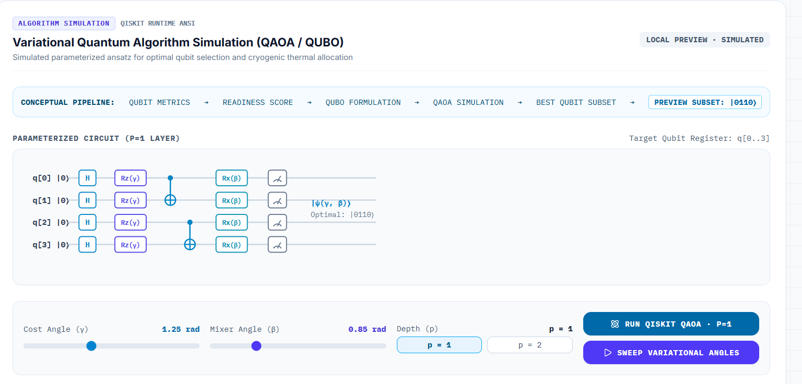

# ❄️ CRYOSIGHT: Quantum Cryogenic Digital Twin & AI Control

## 📌 The Problem: Bridging Cryogenic Stability and Qubit Readiness

Superconducting quantum computers require extremely low temperatures (10–20 mK) for reliable qubit operation. As processors scale, increasing control and readout complexity can affect thermal load and cooling margin, while noise, decoherence, and frequency drift can impact qubit performance.

**The challenge is to connect cryogenic conditions, qubit health, and infrastructure scaling to identify suitable qubits for a given workload.** CryoSight addresses this challenge through a unified software-based digital twin for system monitoring, anomaly analysis, and qubit selection.

## 👥 Who Faces This Problem & Why It Matters?

**Who faces this problem?**
Quantum hardware researchers, cryogenic engineers, quantum computing developers, and research laboratories working with superconducting quantum processors.

**Why is it important?**
As quantum processors scale, maintaining stable operating conditions and assessing qubit performance become increasingly complex. Poor qubit performance and limited cooling margins can affect computational reliability and efficient resource utilization.

**Impact:** Supporting more informed decisions toward reliable and scalable quantum computing.

## 🚀 What Are We Building? (CryoSight)

CryoSight is a **software-based cryogenic digital twin** that simulates a superconducting quantum computing environment and connects cryogenic conditions with qubit health and infrastructure scaling.

The platform integrates:
*   **Cryogenic Digital Twin:** Simulates cooling stages, temperature, thermal load, and cooling margin.
*   **Qubit Health Analytics:** Evaluates simulated T1, T2, readout fidelity, noise, and frequency drift.
*   **AI Anomaly Monitoring:** Identifies unusual patterns in simulated system data.
*   **Infrastructure Scaling:** Explores how increasing qubit counts and representative signal paths affect thermal load.
*   **Quantum Optimization:** Uses a QUBO/QAOA-style simulation to explore suitable qubit selection for a workload.
*   **3D Quantum Lab:** Visualizes the cryogenic system, quantum processor, telemetry, and analysis results.

## ⚛️ Why Quantum Technology?

CryoSight focuses on **superconducting quantum computers**, where qubit performance depends on carefully controlled cryogenic conditions and reliable control infrastructure. Quantum technology is relevant in two ways:

1.  **Quantum Hardware:** The platform simulates the cryogenic environment and qubit-performance parameters of a superconducting quantum processor.
2.  **Quantum Optimization:** QUBO formulation and a QAOA-style simulation explore the selection of suitable qubits while considering readiness, noise, and connectivity constraints.

By connecting cryogenic monitoring with quantum workload optimization, CryoSight explores how intelligent software can support better decisions as quantum systems scale.

## 🔬 Quantum Circuit Implementation (QAOA / QUBO)

Our platform implements a Parameterized Quantum Circuit (P=1 Layer) to solve the QUBO problem of Cryogenic Heat vs. Margin Objective.

**Conceptual Pipeline:**
`Qubit Metrics` → `Readiness Score` → `QUBO Formulation` → `QAOA Simulation` → `Best Qubit Subset` → `Preview Subset: |0110>`

**Circuit Architecture (P=1 Layer):**
*   **Initialization:** Hadamard gates (`H`) on all target qubits (q[0] to q[3]).
*   **Cost Hamiltonian:** `Rz(γ)` gates applied with Cost Angle `γ = 1.25 rad`.
*   **Entanglement:** CNOT gates establishing inter-qubit couplings.
*   **Mixer Hamiltonian:** `Rx(β)` gates applied with Mixer Angle `β = 0.85 rad`.
*   **Measurement:** Qubit state measurement yielding the optimal subset `|0110>`.



*(Refer to the UI implementation in the `QuantumLab.tsx` component for the interactive circuit visualization).*

## 🛠️ Technical Stack

*   **Frontend:** React 19, TypeScript, Vite, Three.js (3D Digital Twin), Recharts (Telemetry), Tailwind CSS v4, Framer Motion, Lucide React.
*   **Backend:** Python 3.11+, FastAPI, Uvicorn, Pydantic.
*   **Quantum & AI:** Qiskit, Qiskit Aer, Qiskit Optimization (QAOA, QUBO), AI Diagnostics (Anomaly Detection).

## 📂 Project Structure

```text
CRYOSIGHT/
├── frontend/               # React + Vite Application
│   ├── src/
│   │   ├── components/     # UI Components (3D, Telemetry, Diagnostics)
│   │   ├── App.tsx
│   │   └── main.tsx
│   ├── .env                # Frontend Environment Variables
│   ├── package.json
│   └── vite.config.ts
├── backend/                # FastAPI + Qiskit Server
│   ├── main.py             # API Endpoints & CORS
│   ├── qiskit_simulator.py # QAOA/QUBO Logic
│   └── requirements.txt
├── docs/                   # Documentation assets
│   └── qaoa_circuit.png
└── README.md
```

> **Simulation notice:** all telemetry, fault scenarios, and quantum measurements are simulated. This project does not control or connect to physical cryogenic or quantum hardware.

## 🧑‍💻 Local Development

**Requirements:** Node.js 20 or newer and npm, Python 3.11 or newer.

### 1. Install and run the backend

```powershell
Set-Location backend
py -3.12 -m venv .venv
.\.venv\Scripts\Activate.ps1
python -m pip install --upgrade pip
python -m pip install -r requirements.txt
python -m uvicorn main:app --reload --host 127.0.0.1 --port 8000
```

FastAPI health check: <http://127.0.0.1:8000/api/health>
Interactive API docs: <http://127.0.0.1:8000/docs>

### 2. Install and run the frontend

```powershell
Set-Location frontend
npm install
npm run dev
```

Open <http://localhost:3000>. Vite listens on port 3000 and the frontend reads `VITE_API_URL` from `frontend/.env` (default: `http://127.0.0.1:8000`).

### API endpoints

`GET /api/health`, `GET /api/telemetry`, `POST /api/fault-injection`, `POST /api/qaoa`.

## ✅ Development checks

```powershell
Set-Location frontend
npm run lint
npm run build
```

To call QAOA directly:

```powershell
Invoke-RestMethod -Method Post -Uri http://127.0.0.1:8000/api/qaoa `
  -ContentType "application/json" -Body '{"gamma":1.25,"beta":0.85,"shots":1024}'
```
